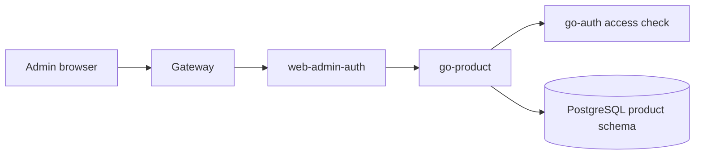

# Product service integration into web-admin

Status: proposed; planning complete, implementation conditional on adapter source availability.
Date: 2026-11-15. Authorization: plan only; no code changes, commits, or deployment.

## Goal and requirement findings

Enable existing administrators to manage the product catalog from web-admin:
products → plans → offers → currency prices, with quota policies under plans.
Use real backend data and existing cookie authentication. Assume full management
of these existing resources is intended, rather than a product list alone.

Acceptance requires persisted create/edit/read flows, supported activation and
deactivation actions, correct free/paid pricing and immutable entitlements,
clear failures, and no regression to IAM or login. No customer subscriptions,
payments, usage counters, categories, new permission system, or public catalog
rollout belongs to this integration. Do not invent delete actions absent from
the API; quota deletion is supported.

The user requires service-specific database schemas and two network tiers:
web/BFF/gateway on `global`; core services, PostgreSQL and Redis on `internal`.
These requirements override descriptions that currently permit core services
on both tiers.

## Inspected baseline

Repositories are separate Git repositories on `main`; the workspace root is
not a Git repository. Inspected HEADs: go-product `cc24ca7`, web-admin
`aedb481`, infra `a0783d5`, go-auth `2993bdb`. The working tree matters:
go-product runtime sources are largely untracked, and infra contains existing
modified files and untracked product manifests. Preserve all existing work.

| Evidence                                                                                                           | Current behavior / gap                                                                                                                                                                                |
| ------------------------------------------------------------------------------------------------------------------ | ----------------------------------------------------------------------------------------------------------------------------------------------------------------------------------------------------- |
| [Product routes](../../internal/transport/restful-api.go)                                                          | Admin CRUD and lifecycle endpoints exist under three aliases; no authentication middleware is registered.                                                                                             |
| [Handlers](../../internal/handler/admin.go), [errors](../../internal/handler/errors.go)                            | Entities are returned directly; lists use resource keys such as `products`, not IAM's `data` envelope. Lists have no server pagination.                                                               |
| [Product service](../../internal/service/admin.go)                                                                 | Activation validates offers/prices; quota and plan edit guards check current `active` status, permitting edits after deactivation. This conflicts with the specification's replacement-plan behavior. |
| [Migration](../../migrations/000001_create_catalog_schema.up.sql)                                                  | Tables are unqualified; no service schema is created.                                                                                                                                                 |
| [Frontend HTTP](../../../web-admin/src/lib/http.ts), [IAM service](../../../web-admin/src/services/iam.service.ts) | Same-origin cookie calls, CSRF and authentication retries exist.                                                                                                                                      |
| [Frontend routes](../../../web-admin/src/components/routes/protected.tsx)                                          | AdminGuard protects IAM routes; no product screens exist.                                                                                                                                             |
| [Product Compose](../../../infra/clusters/prod/go-product/docker-compose.yaml)                                     | Product joins global and go-auth_internal.                                                                                                                                                            |
| [Auth Compose](../../../infra/clusters/prod/go-auth/docker-compose.yaml)                                           | Auth joins both tiers; databases/cache remain internal.                                                                                                                                               |
| [Admin Compose](../../../infra/clusters/prod/web-admin/docker-compose.yaml)                                        | Cookie adapter joins global only and has an image reference, but source is absent from this workspace.                                                                                                |
| [Gateway routes](../../../infra/clusters/prod/gateway/nginx/conf.d/admin.anlew.conf)                               | Existing admin prefix goes to adapter; no product route.                                                                                                                                              |
| [Auth access handler](../../../go-auth/internal/iam/handler.go)                                                    | `/api/admin/v1/access` authenticates session/client credentials and returns current `is_admin`.                                                                                                       |

Referenced `go-auth/specs/2026-10-17-smb-auth-core/00-overview.md` is absent.
Existing README claims about adapter behavior are design context, not verified
adapter implementation. No real environment files or live runtime were inspected.

## Technical design — proposed direction

Gateway and frontend remain on `global`. The adapter joins `global` and the
existing shared internal network `go-auth_internal`. Product and auth become
internal-only; PostgreSQL and Redis remain internal-only. Gateway joins internal
only as needed to preserve existing direct Google callback routing to auth.
Remove its unused product upstream so public ingress has no product bypass.
Do not expose service or database host ports. This network change must preserve
provider callbacks and adapter-to-auth connectivity.

Use browser prefix `/api/product/v1/admin`; route it exclusively to the adapter,
which forwards to the same product prefix on the internal network. Existing
`/api/admin/v1` IAM routes remain unchanged. Preserve existing product aliases
for compatibility, applying identical authorization to all admin aliases.
Do not expose payment, subscription, usage, or general catalog routes at ingress.

The adapter owns cookies, CSRF/origin checks, session refresh, and credentials.
Extend its fixed upstream configuration with a product base URL, never an
arbitrary browser-selected URL. Strip browser-supplied authorization, client
credentials, and identity headers and construct upstream headers from the
validated cookie session and server configuration. Preserve upstream status,
resource response shapes, safe error codes, query parameters and request IDs;
use bounded timeouts and no automatic mutation retries on upstream failures.
Reuse existing authentication/CSRF retry semantics only after inspecting them.

Product must enforce backend authorization independently of UI or BFF checks.
Proposed minimal implementation: on every admin request, call the existing auth
`GET /api/admin/v1/access` using the forwarded bearer session and registered
client headers. Require a valid response with `data.is_admin = true` before
calling handlers. Invalid sessions return 401; authenticated non-admins return
403; auth timeout, malformed response or service failure returns a safe 503.
Fail closed, with no cached positive authorization initially, so revocation and
role changes apply on subsequent requests. Do not log credentials or trust
`X-Is-Admin`. Add an explicit auth upstream configuration and validate it at
startup. This adds one internal call per admin request and avoids duplicating
auth signing keys, role tables or session logic in product.

Use a dedicated `product` schema in the shared PostgreSQL database with a
service-owned role, explicit migration/runtime search path and no writable
public-schema fallback. Do not rewrite an applied initial migration. For a fresh
database create the schema before applying unqualified migrations; for existing
data inventory its actual database/schema, back it up, and prepare a reviewed
forward migration/copy preserving IDs, constraints, indexes and read models.
Moving between databases requires a controlled copy/cutover, not `ALTER TABLE`
across databases. Existing data presence and target database name are deployment
prerequisites, not assumptions that permit destructive reset. Use placeholders
in example DSNs and keep real credentials outside documentation.

Keep current API shapes and numeric fields. Amounts are integer minor units;
reject unsafe JavaScript integers for amounts and quota limits at the frontend
boundary, including received values, so no rounded value can be saved silently.
Use integer inputs in this release and show the currency/minor-unit meaning.
Supporting full int64 beyond JS safe integers would require an explicit compatible
string contract and is outside this proposal. No assumed two-decimal conversion.

Enforce plan immutability after first activation, including after deactivation.
Use a durable activation marker with a forward migration and transactional edit
checks; mark existing active/inactive plans conservatively as previously activated.
Lock/recheck plan state in quota edits and activation to prevent concurrent edits
from bypassing the rule. Inactive plans remain internally readable. Commercial
offer/price updates remain allowed. Keep affected catalog read model updates
atomic; confirm existing mutations and concurrent activation paths satisfy this
before presenting the UI as safe. Do not broaden this into unrelated refactoring.

## Implementation plan — task breakdown

| Task                                 | Outcome and completion criteria                                                                                                                                                                                                                                                                                                                                                                                                                | Dependencies                                                                       |
| ------------------------------------ | ---------------------------------------------------------------------------------------------------------------------------------------------------------------------------------------------------------------------------------------------------------------------------------------------------------------------------------------------------------------------------------------------------------------------------------------------- | ---------------------------------------------------------------------------------- |
| T0: Recover adapter source           | Locate the repository/build context for `web-admin-auth`, inspect its instructions, cookie/refresh/CSRF proxy behavior and build commands. Document exact paths and contract. If unavailable, report the integration dependency; do not replace working login with a new adapter by assumption.                                                                                                                                                | None; blocks adapter work and end-to-end completion.                               |
| T1: Secure and align product backend | Add auth access verification on every admin alias, safe errors and config examples. Add durable plan immutability and concurrency protection; inventory read-model consistency, correcting material violations in affected mutations. Record request/response examples from actual handlers. Build/vet and disposable DB scenarios pass.                                                                                                       | Existing auth access endpoint; adapter not required for direct backend validation. |
| T2: Isolate persistence              | Add product schema/role provisioning and migration instructions, forward migration for activation marker and any existing data transition. Verify service tables resolve only in the intended schema, IDs and snapshots survive, and auth data is unaffected. Keep actual database cutover conditional on target/data inventory.                                                                                                               | Schema choice in this design; coordinate T1 migration ownership.                   |
| T3: Integrate adapter and routing    | Fixed product upstream, trusted session forwarding and CSRF protection; add gateway prefix; remove unused public product upstream; move product/auth internal-only and bridge adapter/gateway as described. Update examples and README together. Validate login, callbacks and IAM after network changes.                                                                                                                                      | T0; T1 authorization contract.                                                     |
| T4: Deliver catalog UI               | Add typed product service using `authedClient`, resource-specific list unwrapping and translated error-code mapping. Add admin-only sidebar and routes `/app/products`, `/app/products/:productId`, `/app/products/:productId/plans/:planId`. Product detail manages metadata/status and plan list; plan detail manages metadata, quotas, offers and currency prices. Reuse dialogs and existing primitives. No fake server pagination/search. | T1 contract; service/types can proceed before T3, live integration requires T3.    |
| T5: Verify and prepare rollout       | Execute linked scenarios; build images, record exact revisions/tags, verify migration/backup and target, document rollout/rollback. No deployment or commit under the planning request.                                                                                                                                                                                                                                                        | T1–T4.                                                                             |

UI must show loading, empty, retry, denied, missing-resource and service-unavailable
states; retain input on failure and prevent duplicate submits. Cancel obsolete
requests, refresh affected parent/child data after mutation, and refetch on state
conflicts. Draft-only entitlement editing must match durable backend rules;
show activation prerequisites and explain replacement plans. Confirm deactivation
and quota deletion. Provide translated labels, validation, errors and accessible
keyboard dialogs; use locale-aware dates. Preserve all existing IAM navigation.

Run UI type-check/lint/build and changed-file Prettier checks. For backend changes,
format Go and run `go build ./...`, `go vet ./...`, then disposable HTTP/SQL flows.
Use adapter's actual existing commands once T0 is resolved. Validate Compose
without secret interpolation/env resolution, then Nginx in its real image with
upstreams available. No new unit tests or screenshots.

## Release and rollback

Prepare schema and compatible additive migrations first, then secured product,
then adapter/network/gateway, then frontend. Coordinate network changes in one
maintenance window if mixed manifests would disconnect auth or callbacks.
Confirm `/ready` and admin workflow through ingress; gateway liveness is insufficient.
Use immutable image tags. Roll back frontend and routing before backend if needed;
retain additive schema/activation metadata and restore previous schema connection
only with a proven data-compatible path. Never delete volumes or run initial down
migrations. No actual production target has been selected.

## Readiness and next action

The design and independent backend/UI preparation tasks are ready for review.
Full integration is conditional on locating the adapter source. Existing database
state/target and runtime host are required before migration execution/deployment.
The specification's immutability requirement is the proposed authority for closing
the current deactivation loophole. No implementation is authorized by this plan.

Next: review the proposed scope and design, then obtain implementation authorization;
start by locating adapter source and establishing backend/schema contracts.
Functional verification is defined in [01-test-spec.md](01-test-spec.md).
